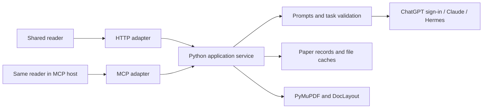

# Shared application core and storage responsibilities

Status: accepted; shared Python core and local MCP adapter implemented.

## Problem

The experimental Sites port duplicates document processing, task preparation,
result validation and persistence policy. Reusing the reader's appearance does
not make it the same product: the Python engine uses DocLayout-YOLO and PyMuPDF,
whereas the hosted port uses browser PDF.js extraction and optional English OCR.
The two implementations also have different artifact and paper identities.

The intended boundary is a single application core with interchangeable user
interfaces and thin transport adapters. A frontend must not independently decide
paper identity, source validity, task contracts, cache validity or retention.

## Core boundary

Extract application use cases from FastAPI into a transport-independent Python
service. HTTP routes translate requests, domain errors and streams; document
processing and task execution belong to the service. `app/ai.py` remains the only
prompt owner and `app/backends/` remains the only AI process boundary. Preserve
the existing local HTTP contract and Paper ID/File Fingerprint distinction.

The MCP adapter must call these same use cases. It must not call HTTP route
functions, duplicate prompts, or return saved output as if live generation ran.
UI resources should consume the same source and task results as the local reader.

This extraction does not by itself complete plugin integration. A remote ChatGPT
host cannot directly reach a loopback-only service. Public connectivity and
authentication require a deployment decision; no tunnel or public listener is
enabled by this change. Host headers alone are not an authentication mechanism.
The standalone MCP HTTP adapter serves only its authenticated loopback endpoint;
it does not make the local reader's unauthenticated API remotely safe. MCP Apps
visibility metadata guides hosts, while the local parent process or bearer
holder remains the single trusted principal. Multi-user deployment requires a
separate authorization and tenant-isolation design.

The independent hosted port did not establish core parity. Its TypeScript
generation instructions were a second prompt owner, including a structured
glossary contract unlike the local plain-text brief. Fixing that port's internal
contracts did not resolve the duplication, so its runtime and reader fork are
retired from the checkout. Source provenance remains in commit
`df174cacf924c31df710750219b058199d254391` and the original port branch.
No deployed D1/R2 data is deleted or migrated. Never silently replace the
required local layout model with approximate browser extraction.

AI execution is independent of frontend selection. The local application already
supports ChatGPT sign-in and subscription-backed execution alongside Claude and
Hermes. Preserve that choice; do not equate a local frontend with CLI-only AI or
a plugin frontend with a different set of business rules. The plugin invokes
that same backend boundary through the service. Conversation generation followed
by result submission is not a second supported inference mode: it would duplicate
contracts and weaken the tool-disabled boundary.

Task language is also part of result identity. Normalize legacy names and codes
at the core boundary, while retaining meaningful script differences such as
Simplified and Traditional Chinese. A frontend-specific alias table must not
silently reuse the wrong language's results.

## Does this application need a database?

The single-user local application does not currently need a database. It reads
PDFs from a library and uses content-addressed files and JSON records. Adding SQL
would not resolve duplicated business rules or provide parsing parity.

A hosted multi-user installation needs an owner-scoped index for library listing,
metadata, access control, object references and accounting. Small mutable user
records can live there. PDF bytes, figure images and large extracted/result JSON
belong in file/object storage. An index should reference those payloads rather
than turning its row budget into a document-content budget.

| Data | Responsibility | Local storage | Hosted storage if retained |
| --- | --- | --- | --- |
| Original PDF | Durable source | Existing file storage | Private object storage |
| Notes, tags, collections | Durable user work | Small records if introduced | Indexed owner-scoped records |
| Chat history | Durable user work | Paper-ID records | Paper-ID records with atomic append |
| Bibliography, reading position | Small persistent state | Existing records | Small indexed records |
| Translation, summary, anatomy, glossary, equations | Expensive reproducible results | File cache | Object payload plus index |
| Layout, extracted text, title lookup | Reproducible cache | File cache | Object payload plus index if needed |
| Prepared tasks, progress, review ZIP | Transient | Memory or temporary output | Memory or temporary output |
| Credentials | Secret configuration | Existing protected credential store | Separate credential system, never library rows |

Chat is user work even when it contains model output. It must not be evicted as
if it were a translation cache. Expensive results should remain available until
the user chooses a retention policy; reproducible does not mean free to regenerate.

Sharing the core also requires safe concurrent persistence. Chat writes use a
short cross-process file lock and atomic replacement. Each request reasons from
its starting history snapshot; completed exchanges append in completion order.
A reset advances a durable generation marker. An answer started before that
reset is rejected instead of restoring cleared turns, and legacy migration must
respect the marker. Public chat history stays a list; legacy list files remain
readable. Lock acquisition in async request paths runs off the event loop.
Identity moves carry a distinct lineage marker so a later identity correction can
move history back without overwriting a reset or independent history. Interrupted
moves may leave duplicate complete records; no automatic merge or reconciliation
is performed. A reset followed by new history can also require explicit identity
reconciliation rather than overwriting an existing fence.

## Existing limits and their consequences

These are application limits read from the experimental port, not verified
provider limits or measured production usage:

- 2,000 library rows; PDF limit 20 MiB each and 500 MiB per owner.
- Extracted pages 1–200, 300,000 UTF-8 segment bytes per page, 50 MiB per owner.
- Analysis artifacts 300,000 UTF-8 bytes each, 20 MiB or 2,000 rows per owner.
- Selected figures 2 MiB each, 100 MiB or 1,000 rows per owner.
- Review export 12 MiB.

Append-only translation batches consume the analysis row limit as normal usage.
For example, 20 pages at five batches per page consume 100 rows per paper; twenty
such papers consume 2,000 rows regardless of remaining bytes. Superseded analyses
and figures also count. The original port has no paper/result deletion path, so
increasing a cap only delays exhaustion. SQL payload-byte sums also exclude row,
index and metadata overhead; they do not measure actual database allocation.
Replacing a PDF does delete its previous PDF object and page rows, but does not
provide a general result or paper cleanup lifecycle.

A source payload budget is a request-size policy, not proof that a source has
changed. Compute source validity independently so a stricter byte budget cannot
make previously saved, unchanged results appear stale.

Reconsider append-only retention for reproducible results. A current-result index
and explicitly selected history are better than treating every batch retry or
source revision as a permanent library record. Any replacement must preserve
idempotent retries, source-version fences and user-authored history. Quotas need
visible usage and a recoverable action rather than a permanent save failure.

The local implementation has no corresponding byte quota. Copies of PDFs and
superseded cache revisions can accumulate. No user data was inspected to measure
actual usage. This work does not delete existing copies, migrate payloads, merge
paper identities or automatically prune old results.

## Decisions still required

The user clarified that local execution can also use ChatGPT sign-in. Frontend
selection therefore does not select the model provider or its authentication.
Use the existing execution backends and one Python core. MCP connectivity is a
transport/deployment concern; hosted identity headers do not supply model
execution or a Python parsing runtime.

After that decision, define result retention and source-copy policy before any
destructive migration. A remotely reachable single-user core still needs an
authenticated transport; a hosted multi-user core additionally needs explicit
tenant isolation. Conversation-generated output with connector tools available
must not be represented as satisfying ADR 0002's tool-disabled inference boundary.

## Acceptance evidence

Completion requires direct service tests and unchanged HTTP behavior, followed
by both frontends exercising the same use cases. A separate schema in each
runtime or a successful MCP response alone does not prove interchangeability.
Use synthetic papers to verify file/paper identity, ordered translation and
cache hits, stale-source rejection, error mapping, and durable chat behavior.
Storage lifecycle tests must prove reclaimed quota and retained user work once
the retention policy is implemented. Builds and tool responses do not prove
that an embedded reader rendered or is accessible in its host.

The native service/HTTP/MCP tests and shared-reader browser fixtures exercise the
implemented boundary with synthetic papers. Released MCP Inspector 2.12.0 also
renders the actual resource under its original opaque sandbox and CSP, including
source highlighting, upload and host-mediated review download. That host does
not forward per-event progress to its iframe, so its verified translation path
uses the final-event fallback. At ordinary desktop width, native Maximize,
hiding the monitoring pane and Fit Width make the source readable; the default
narrow embedded layout remains a limitation. None of this proves actual
ChatGPT-host behavior, personal account access or a live AI backend call.
